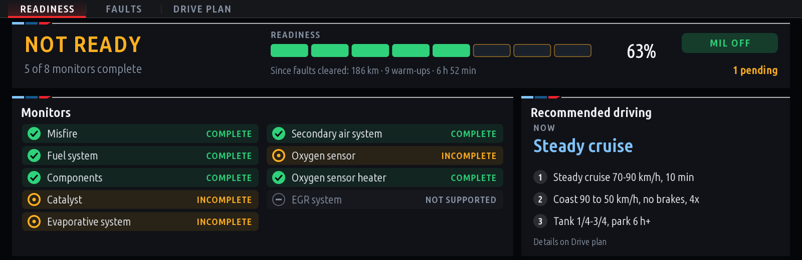
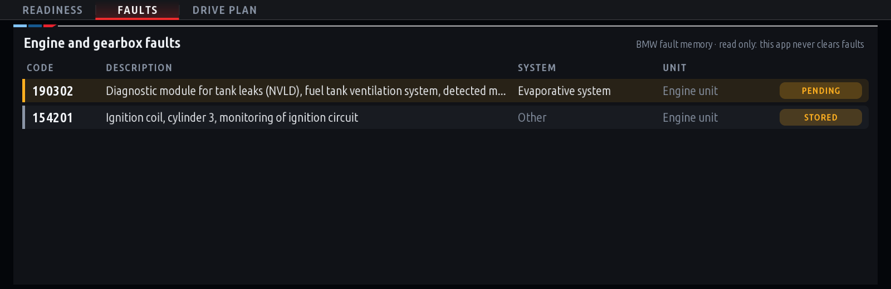
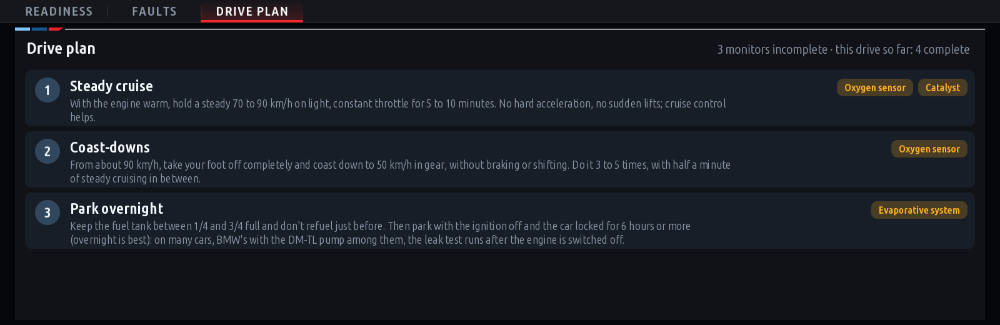

<h1 align="center">Readiness for iDrive 7</h1>

<p align="center">
  <b>A read-only emissions readiness and fault app for the BMW MGU head unit (iDrive 7 / iDrive 8).</b><br>
  A progress bar of the readiness monitors, BMW's own fault codes, and the driving that completes the rest.
</p>

<p align="center">
  
</p>

<table>
<tr>
<td width="50%"><br><b>Faults</b>: the engine and gearbox fault memory as BMW hex codes with BMW's text, the readiness system each belongs to, and its state</td>
<td width="50%"><br><b>Drive plan</b>: the steps that complete the incomplete monitors, in order</td>
</tr>
</table>

This repository is a fork of [cauliflowermossgrape/idrive7-apps](https://github.com/cauliflowermossgrape/idrive7-apps),
trimmed to this one app. It keeps that project's app kit (`kit/`: the runtime, GPU renderer, controller gate,
emulator and build tools) and its installer (`deploy/`), which Readiness needs to build and install. The other
apps, and their tests and documentation, are in the original repository.

## The app

Everything about the app is in [`apps/readiness/README.md`](apps/readiness/README.md): the pages, the monitors it
tracks (misfire, fuel system, components, catalyst, heated catalyst, evaporative system, secondary air, A/C
refrigerant, oxygen sensor, oxygen sensor heater, EGR), how it reads BMW fault codes, and the exact list of requests
it is allowed to send.

**It only reads.** Every request goes through [`apps/readiness/link.js`](apps/readiness/link.js), which refuses
anything that isn't one of a fixed list of reads to the engine unit(s) and gearbox before it reaches the car. It
never clears faults, codes, resets or actuates anything.

## What you need

- **A BMW with the MGU head unit** (iDrive 7 or iDrive 8).
- **Root shell access to the head unit** (SSH). This project does not provide it.
- **BMW's app SDK (`oap-sdk`), extracted from your own unit.** It's BMW's copyrighted code, so it isn't in this
  repository; [`kit/tools/extract_sdk.js`](kit/tools/extract_sdk.js) rebuilds it from an app on the unit.
- **Python 3.6+ and Node.js 14+** on your PC (Windows, macOS or Linux). No npm packages, no compiler.

## Quick start

**1. Get the SDK from your unit**

```sh
scp root@<unit>:'/usr/lib/oap-mainapp/preinstalled_apps/x_call@*.tgz' .
mkdir x_call && tar xzf x_call@*.tgz -C x_call
node kit/tools/extract_sdk.js x_call/javascript/app.js     # writes ./oap-sdk/
```

`oap-sdk/` is in `.gitignore`. Never commit it.

**2. Test and build**

```sh
node kit/tools/test_readiness.js                 # the read-only guard, decoding, and the app on a fake head unit
python3 kit/tools/build.py readiness             # -> dist/readiness@<ver>.mgu
python3 kit/tools/build.py --preview-only readiness   # without the SDK: an offline preview, not installable
```

(On Windows type `python` instead of `python3`.) The `.mgu` contains BMW's SDK, so keep it for your own car and don't
publish it.

**3. Install on the car**

Car parked, ignition on, ideally with a battery charger connected. Pack the kit (the app, the installer and the GPU
renderer), then push it over SSH:

```sh
deploy/make-car-kit.sh                 # macOS / Linux / WSL -> dist/mgu-custom-apps.tar.gz
deploy\make-car-kit.cmd                # Windows
HU=root@<unit-ip> PORT=22 KEY=~/.ssh/id_mgu deploy/push-to-car.sh check     # read-only: checks the unit first
HU=root@<unit-ip> PORT=22 KEY=~/.ssh/id_mgu deploy/push-to-car.sh install   # backup -> install -> restart the app platform
```

On Windows, `deploy/push-to-car.ps1` does the same with Windows' own OpenSSH:

```powershell
powershell -ExecutionPolicy Bypass -File deploy\push-to-car.ps1 check   -Key <path>\id_rsa -Ip <unit-ip>
powershell -ExecutionPolicy Bypass -File deploy\push-to-car.ps1 install -Key <path>\id_rsa -Ip <unit-ip>
```

After 1-2 minutes **Readiness** appears under **Apps**.

**Back to stock:** `deploy/push-to-car.sh restore` (or `sh deploy-car.sh restore` on the unit) removes the app, the
hook and the boot drop-in, and puts every touched file back from the first backup the installer made.

The full guide to the head unit, the installer, the renderer, writing apps and troubleshooting is in the
[original project's README](https://github.com/cauliflowermossgrape/idrive7-apps#readme).

## Repository layout

| Path | What it is |
|---|---|
| `apps/readiness/` | the app: `main.js` (pages, polling), `link.js` (the read-only guard), `monitors.js` (readiness decoding, drive plan), `bmw.js` + `bmw_dtc.pack` (BMW fault codes and texts), `demo.js` (demo car) |
| `kit/runtime/` | the app runtime every app is built with (drawing, settings, diagnostics transport, data packs) |
| `kit/renderd/` | the GPU renderer (mgu-render) and the controller gate, prebuilt |
| `kit/tools/` | `build.py`, `make_kit.py`, `extract_sdk.js`, the emulator and preview, and the tests |
| `kit/emu/` | the live emulator (see [docs/emulator.md](docs/emulator.md)) |
| `deploy/` | the installer and the scripts that push it to the car |

Never commit `oap-sdk/`, `dist/`, or anything that identifies a car (VIN, keys, provisioning files).

## Credits and licences

The app kit, installer and the original apps are by
[cauliflowermossgrape](https://github.com/cauliflowermossgrape/idrive7-apps). The Chinese UI translation in
`kit/localization` is by 小白151 ([JackieZ123430](https://github.com/JackieZ123430)); see
[NOTICE.zh-CN.md](NOTICE.zh-CN.md).

The repository is MIT-licensed ([LICENSE](LICENSE)), except the GPU renderer, `kit/renderd`, which is
[mgu-render](https://github.com/robertnisipeanu/mgu-store) by Robert Nisipeanu and IterioDev, GPL-3.0-or-later
(`kit/renderd/LICENSE`); the parts it took from the original project's first renderer stay MIT
(`kit/renderd/LICENSE.mgu-renderd`), and the controller gate in `kit/renderd/inputgate` is MIT. The emulator's build
of the draw engine, `kit/emu/wasm` and `kit/emu/web/gfx`, contains its code, so it is GPL-3.0-or-later too.

BMW's SDK and interface generator are not included: both are loaded from your own unit's firmware.
